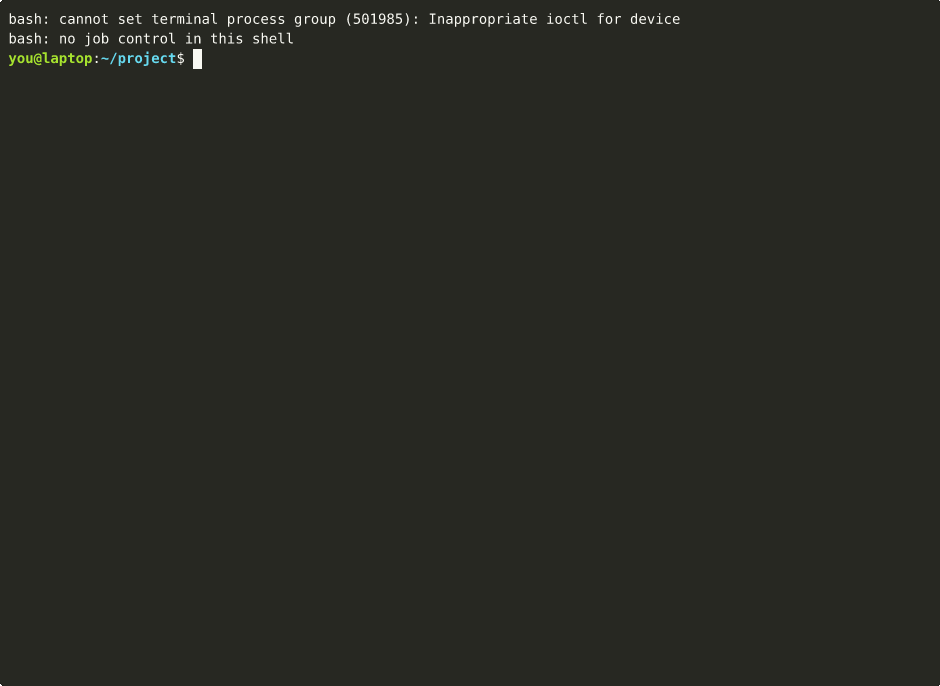

# pi-ard

[Agentic Resource Discovery (ARD)](https://github.com/ards-project/ard-spec) for [Pi](https://pi.dev). It lets Pi search any ARD registry and browse a domain's catalog. Skills and MCP servers are installed only after **you** confirm in Pi's UI.

```
pi install git:github.com/zeroasterisk/pi-ard
```

> find me an MCP server for Hugging Face and add it

Pi calls `ard_search` and shows where each result comes from, whether it is trusted, and whether it is signed. Before anything is written or registered, Pi asks you.




Real session, nothing staged: [demo/](demo/). Hugging Face walkthrough with exact output: [docs/SCENARIOS.md](docs/SCENARIOS.md).

## What it adds

| Surface | What it does |
| :-- | :-- |
| `ard_search` | `POST {registry}/search` (ARD §5.3). Read-only. |
| `ard_catalog` | `GET https://{domain}/.well-known/ard.json` (§5.1). If that is missing it falls back to `ai-catalog.json`. Trusted domains only. Read-only. |
| `ard_install` | Takes an identifier returned earlier by search or catalog. It then either writes a skill to `<agent-dir>/skills/<name>/` or registers an MCP server for the current session. Every install goes through `ctx.ui.confirm`. |
| `/ard` | Shows the config path, registries, trusted domains and installed skills. |

That is the full surface. pi-ard has no "pre-confirmed" flag, no auto-install, and no background updates.

## Point it at any ARD registry

Config lives at `~/.pi/agent/pi-ard/config.json` (override with `PI_ARD_CONFIG`). It is user-level only and never read from a project directory.

```json
{
  "registries": [
    { "name": "team",        "url": "https://ard.internal.example.com" },
    { "name": "huggingface", "url": "https://huggingface-hf-discover.hf.space" },
    { "name": "github",      "searchUrl": "https://agentfinder.github.com/api/v1/search" }
  ],
  "trustedDomains": ["internal.example.com", "huggingface.co", "github.com", "raw.githubusercontent.com"]
}
```

Trust follows the identifier, not the registry that returned it. Hugging Face's own skills come back from HF Discover as `urn:air:github.com:huggingface:skills:…` with the file on `raw.githubusercontent.com`, so trusting them takes `github.com` and `raw.githubusercontent.com`. Note that `github.com` then covers every GitHub-hosted publisher, not just Hugging Face; that is the granularity ARD's `urn:air:<domain>` gives today.

- `url` is a registry base URL; `/search` is appended. `searchUrl` is used exactly as given, for registries that serve search somewhere else.
- The first registry is the default. The model can name another one by its `name`.
- `trustedDomains` decides which domains `ard_catalog` may fetch and which results count as **trusted**. Subdomains match too, so `example.com` also covers `api.example.com`. A result is trusted only when its publisher (from `urn:air:<publisher>:…`) **and** the host it would be fetched from are both on the list.
- With no config file, the default is Hugging Face Discover, with `huggingface.co` trusted.

To run your own registry, see [`examples/private-registry`](examples/private-registry). It's about 60 lines and implements ARD `/search` and `ard.json`.

## Trust, signatures and attestations: what's real today

ARD v0.91 defines a `trustManifest` (identity, attestations, provenance) but leaves signing and verification to external trust frameworks. No such framework is finalized yet. Here is what pi-ard does with that:

| Check | Status |
| :-- | :-- |
| HTTPS only. Plain HTTP only for loopback, so owners can test locally. No credentials in URLs. | enforced |
| Redirects only for GET and only to the same host. POST redirects are never followed. | enforced |
| 15 s timeout and 1 MB response cap (256 KB for SKILL.md) | enforced |
| Entry structure (§4): `urn:air` identifier, exactly one of `url` or `data` | enforced. Invalid entries are listed but cannot be installed. |
| §4.5.1 publisher binding: `trustManifest.identity` (SPIFFE, did:web, https) must be in the publisher's domain | enforced. A mismatch is refused. |
| `trustManifest` present | shown with the declared attestation types, labeled **"signature and attestations NOT verified"** |
| Signature or attestation verification | **not done**. pi-ard has nothing to verify against yet, so it never claims verification. |
| Installed skill integrity | Source URL and sha256 are recorded in `<agent-dir>/pi-ard/lock.json` |

`score` is relevance, never trust. Descriptions are third-party text and are passed to the model labeled as data.

When a trust framework is finalized, verification goes in `src/core/entry.ts` (`checkEntry`). It can add a `verified` signature state without changing any other surface.

## What gets installed, and how

**Skills** (`application/agent-skills+md`, plus the `application/ai-skill` alias that HF and GitHub return):
- The source URL is resolved from `metadata.raw_url`, from a GitHub `blob/…/SKILL.md` URL rewritten to `raw.githubusercontent.com`, or from any other URL ending in `SKILL.md` (HF Space skills are served by Discover that way). GitHub `tree/` directory pages are refused, never guessed.
- You confirm **before** anything is fetched. The file must have frontmatter with a `description` (Pi skips skills without one) and a valid Agent Skills name. pi-ard never overwrites an existing skill.
- Only `SKILL.md` is installed. If it cites bundled files (`scripts/…`, `references/…`), the result lists them as missing so you can fetch the rest from the source.
- Run `/reload` to load the skill.

**MCP servers** (`application/mcp-server-card+json`, plus the `application/mcp-server+json` alias from the MCP registry):
- If the card's host is untrusted, you confirm **before the card is fetched**.
- A streamable-http remote is preferred and must be HTTPS. For stdio packages (`uvx`, `npx` or `docker`, with the version pinned) you confirm **twice**, because a stdio server runs a local process.
- Servers are registered for the current session only, through `pi.registerMcpServer`. The result includes the `pi mcp add …` command if you want to keep it.

**A2A agents, registries and nested catalogs** are shown in results but not installed. The tool explains what to do instead.

## Why not an ARD SDK?

As of 2026-10 there is no official ARD SDK. The `ards-project` org publishes only the spec and connectors. The npm packages `ai-catalog` and `ai-catalog-sdk` implement the predecessor AI Catalog format, not the v0.91 `/search` API. The client here is small and isolated in `src/core` (no Pi imports), so it can be swapped for an official SDK when one ships. See [docs/DESIGN.md](docs/DESIGN.md).

## Development

```
npm ci
npm run check          # typecheck + offline tests (unit, contract, real Pi AgentSession e2e)
npm run test:live      # opt-in: real Hugging Face + GitHub registries
node --experimental-strip-types examples/rpc-smoke.ts   # real `pi --mode rpc`, confirm over RPC
```

See [CONTRIBUTING.md](CONTRIBUTING.md). Report security issues as described in [SECURITY.md](SECURITY.md).

## License

Apache-2.0. Test fixtures under `test/fixtures/spec/` come from [ards-project/ard-spec](https://github.com/ards-project/ard-spec) (Apache-2.0). See [NOTICE](NOTICE).
